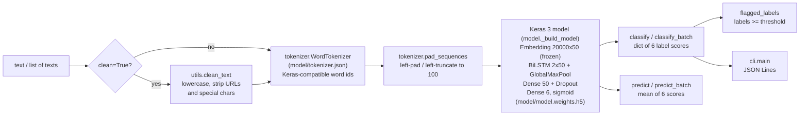

<div align="center">

# Toxic Comment Classifier

**A pre-trained BiLSTM that scores comments for six kinds of toxicity, offline, in one line of Python.**

[](https://pypi.org/project/toxic-comment-classifier/)
[](https://pypi.org/project/toxic-comment-classifier/)
[](https://pepy.tech/projects/toxic-comment-classifier)
[](https://github.com/irfanalidv/toxic_comment_classifier/actions/workflows/tests.yml)
[](https://github.com/irfanalidv/toxic_comment_classifier/actions/workflows/codeql.yml)
[](https://github.com/irfanalidv/toxic_comment_classifier/blob/main/LICENSE.txt)
[](https://github.com/astral-sh/ruff)
[](https://mypy-lang.org/)
[](https://github.com/irfanalidv/toxic_comment_classifier/blob/main/CONTRIBUTING.md)

</div>

## Why

Most moderation pipelines either call a paid API (latency, cost, data leaves your servers) or
pull in a large transformer. This library ships a small, pre-trained multi-label model inside the
wheel: install it, and you can score comments on a CPU with no network, no API key and no model
download. It returns the six [Jigsaw Toxic Comment Classification](https://www.kaggle.com/c/jigsaw-toxic-comment-classification-challenge)
labels, so you can build your own moderation policy on top.

## Features

| | |
| --- | --- |
| **Six labels, multi-label** | `toxic`, `severe_toxic`, `obscene`, `threat`, `insult`, `identity_hate`, each scored independently from 0 to 1 |
| **Bundled and offline** | Weights (4.6 MB) and vocabulary (19,999 words) ship in the package; nothing is downloaded at runtime |
| **Simple API** | `classify()` for per-label scores, `predict()` for one overall score, batch versions of both, `flagged_labels()` for thresholds |
| **Batched inference** | A list of texts goes through the network in one `model.predict` call |
| **CLI** | `toxic-classifier "some comment"` prints JSON Lines; reads stdin too |
| **No pickle, no Keras internals** | The vocabulary is plain JSON read by a small built-in tokenizer, so Keras upgrades do not break loading |
| **Typed** | Ships `py.typed`; checked with mypy in CI |

## Install

```bash
pip install toxic-comment-classifier
# or
uv pip install toxic-comment-classifier
```

Requires Python 3.10 to 3.13. TensorFlow (>= 2.16) and Keras 3 are installed as dependencies.
There are no optional extras.

## Quickstart

```python
from toxic_classifier import ToxicCommentClassifier

model = ToxicCommentClassifier()  # loads the bundled weights, no network

text = "You are so dumb and stupid!"
print(model.classify(text))
# {'toxic': 0.9889..., 'severe_toxic': 0.0725..., 'obscene': 0.6204...,
#  'threat': 0.0193..., 'insult': 0.8664..., 'identity_hate': 0.0407...}

print(f"{model.predict(text):.4f}")          # 0.4347  (mean of the six labels)
print(model.flagged_labels(text, 0.5))       # ['toxic', 'obscene', 'insult']

texts = ["I hate you so much!", "This is wonderful news.", "Have a nice day :)"]
print([round(s, 4) for s in model.predict_batch(texts)])  # [0.1395, 0.0013, 0.0115]
```

Note the import name is `toxic_classifier` (the PyPI name is `toxic-comment-classifier`).

### Command line

```bash
toxic-classifier "go kill yourself"
# {"text": "go kill yourself", "toxicity": 0.374754, "flagged": ["toxic", "insult"], "scores": {"toxic": 0.888507, ...}}

# One comment per line from stdin, JSON Lines out
cat comments.txt | toxic-classifier --threshold 0.7
```

Options: `--threshold` (0 to 1, default 0.5), `--clean` (apply `clean_text()` first), `--version`.

## How it works



Key design decisions:

- **Architecture rebuilt in code, weights loaded from `.h5`.** The network (about 1.05 M
  parameters, 1 M of them in the frozen embedding) is defined with the public Keras 3 API and
  only the weights are loaded, so there is no dependency on a serialized model format.
- **Tokenizer reimplemented, vocabulary as JSON.** `WordTokenizer` reproduces Keras
  `Tokenizer.texts_to_sequences` (same filters, lowercasing and `num_words` cutoff) and
  `pad_sequences` reproduces the Keras defaults. Release 0.4.0 verified identical token ids and a
  maximum score difference of 1.2e-7 against the original pickled tokenizer.
- **Sigmoid outputs, not softmax.** Labels are independent: a comment can be both `obscene` and
  an `insult`. `predict()` is simply the mean of the six scores.
- **Lazy, local TensorFlow.** TensorFlow is imported when the classifier is built (the CLI parses
  arguments first), and `TF_CPP_MIN_LOG_LEVEL` defaults to `2` to hide C++ info logs.

## Use cases and recipes

Every example runs offline with only the package installed.

| Script | What it shows |
| --- | --- |
| [`examples/quickstart.py`](https://github.com/irfanalidv/toxic_comment_classifier/blob/main/examples/quickstart.py) | Per-label scores, overall score, flagged labels and a batch |
| [`examples/moderation_queue.py`](https://github.com/irfanalidv/toxic_comment_classifier/blob/main/examples/moderation_queue.py) | A simple approve / review / reject / escalate policy built on `classify_batch()` |
| [`examples/filter_dataset.py`](https://github.com/irfanalidv/toxic_comment_classifier/blob/main/examples/filter_dataset.py) | Drop toxic rows from a CSV before training another model |
| [`examples/community_health.py`](https://github.com/irfanalidv/toxic_comment_classifier/blob/main/examples/community_health.py) | Share of flagged messages per day, channel and author for a dashboard |

The scripts use a 12-row sample file, [`examples/data/comments.csv`](https://github.com/irfanalidv/toxic_comment_classifier/blob/main/examples/data/comments.csv).

**Limitations.** Scores are model estimates, not ground truth. Like any model trained on Jigsaw
data, it can be wrong on sarcasm, reclaimed slurs, non-English text, and identity terms in
neutral contexts. `clean_text()` keeps only ASCII letters and digits. Keep a human in the loop for
consequential decisions, and tune thresholds on your own labelled data.

## Configuration

| Option | Where | Default | Effect |
| --- | --- | --- | --- |
| `clean` | `ToxicCommentClassifier(clean=...)` | `False` | Apply `clean_text()` before scoring |
| `batch_size` | `ToxicCommentClassifier(batch_size=...)` | `256` | Inference batch size for lists (must be a positive int) |
| `threshold` | `flagged_labels(text, threshold=...)`, CLI `--threshold` | `0.5` | Score at which a label counts as flagged |
| `TF_CPP_MIN_LOG_LEVEL` | environment | set to `2` if unset | TensorFlow C++ log verbosity |
| `KERAS_BACKEND` | environment | `tensorflow` | Keras 3 backend; TensorFlow is the tested one |

## API overview

| Name | Returns |
| --- | --- |
| `ToxicCommentClassifier(clean=False, batch_size=256)` | Loads the bundled model |
| `.classify(text)` | `dict[str, float]`: score per label |
| `.classify_batch(texts)` | `list[dict[str, float]]` |
| `.predict(text)` | `float`: mean of the six label scores |
| `.predict_batch(texts)` | `list[float]` |
| `.flagged_labels(text, threshold=0.5)` | `list[str]`: labels with score >= threshold |
| `toxic_classifier.clean_text(text)` | Lowercased text without URLs and special characters |
| `toxic_classifier.LIST_CLASSES` | The six label names, in output order |
| `toxic_classifier.tokenizer.WordTokenizer` | Keras-compatible word tokenizer (`from_json`, `texts_to_sequences`) |

Passing a single string to a `*_batch` method raises `TypeError`; non-string items raise
`TypeError`; an empty list returns `[]`.

## Research and references

The model is a standard recurrent text classifier; it builds on:

- S. Hochreiter and J. Schmidhuber. *Long Short-Term Memory.* Neural Computation 9(8), 1997.
- M. Schuster and K. K. Paliwal. *Bidirectional Recurrent Neural Networks.* IEEE Transactions on
  Signal Processing 45(11), 1997.
- Labels and training data: [Jigsaw / Conversation AI, Toxic Comment Classification Challenge](https://www.kaggle.com/c/jigsaw-toxic-comment-classification-challenge), Kaggle, 2018 (159,571 training comments).

## When to use it

Use it when you want a small, dependency-light (beyond TensorFlow), offline first-pass filter
with the Jigsaw label set. If you need higher accuracy, multilingual input, or bias-mitigated
scores, transformer-based models (for example [Detoxify](https://github.com/unitaryai/detoxify))
are a better fit, at the cost of a larger model and download.

## Roadmap

- Publish evaluation metrics (ROC-AUC per label) on the Jigsaw test split.
- Optional lighter runtime (for example ONNX export) to avoid the full TensorFlow dependency.
- Configurable per-label thresholds in the CLI.

## Contributing, security, citation, license

- Contributions are welcome: see [CONTRIBUTING.md](https://github.com/irfanalidv/toxic_comment_classifier/blob/main/CONTRIBUTING.md) and the [Code of Conduct](https://github.com/irfanalidv/toxic_comment_classifier/blob/main/CODE_OF_CONDUCT.md).
- Report vulnerabilities as described in [SECURITY.md](https://github.com/irfanalidv/toxic_comment_classifier/blob/main/SECURITY.md).
- Release notes: [CHANGELOG.md](https://github.com/irfanalidv/toxic_comment_classifier/blob/main/CHANGELOG.md).
- If you use this in research, please cite it using [CITATION.cff](https://github.com/irfanalidv/toxic_comment_classifier/blob/main/CITATION.cff).
- MIT licensed: see [LICENSE.txt](https://github.com/irfanalidv/toxic_comment_classifier/blob/main/LICENSE.txt).

<details>
<summary>Development setup</summary>

```bash
git clone https://github.com/irfanalidv/toxic_comment_classifier.git
cd toxic_comment_classifier
uv venv && uv pip install -e ".[dev]"
pre-commit install
ruff check . && ruff format --check .
mypy toxic_classifier
pytest --cov=toxic_classifier
```

</details>
